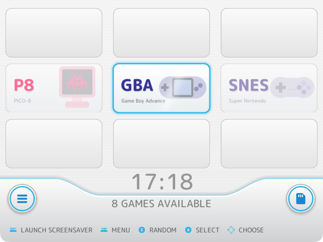
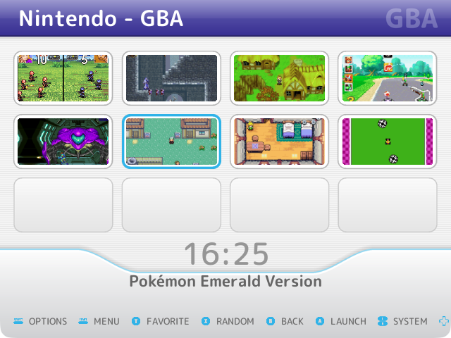
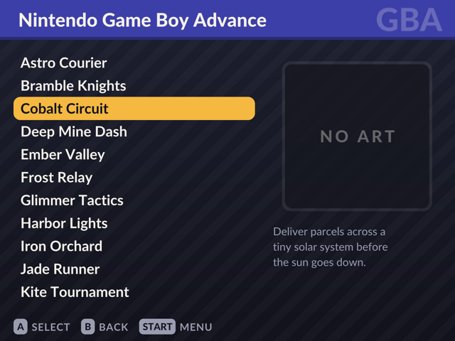

# es-wii-theme

**Wii** is an EmulationStation theme for ArkOS on 640×480 handhelds like the **R36S**, made to be
added to [Jetup13's EmulationStation OGA Theme Gallery](https://github.com/Jetup13/Emulationstation-OGA-Theme-Gallery)
like the themes already there.

It looks like the Wii's menu: a pinstriped white background with rows of channel slots, each system a white
channel in the middle row, styled after Wii Sports': its short name big in its own color, its full name under it,
and its controller or console as a big faint picture on the right. The selected one has a blue frame and slowly
comes alive, and the curved dock runs along the bottom with the clock. Each maker's systems share a family of
colors.

A system's games are channels too: game lists open as a grid of four by three, each game's screenshot in a white
bezel, with empty slots filling the rest of the page. Like the Wii, the tiles stay put and the blue outline moves.
The list view (Start → UI Settings → Game List View → Detailed) has a band in the system's color across the top,
the games in a white panel with a light blue selector, and the box art and description in a panel beside it.

| Systems | Games | Game list (Detailed) |
| --- | --- | --- |
|  |  |  |

The previews are screenshots of ArkOS's own EmulationStation
([EmulationStation-fcamod](https://github.com/christianhaitian/EmulationStation-fcamod), `351v` branch) built for
macOS, not taken on the console. It's been tried on an R36S, where it looks the same.

## Installing

The repository is the theme: `theme.xml` is at its top, with `art/`, `assets/` and `fonts/` beside it. Either:

- install it with [ThemeMaster](https://github.com/JohnIrvine1433/ThemeMaster) on the console, or
- download it from GitHub (**Code → Download ZIP**) and unzip it into the `themes` folder on the card's
  `EASYROMS` partition, so that it's `themes/es-wii-theme/theme.xml` (rename the folder from `es-wii-theme-main`
  if you like; ES shows the folder's name).

`./build.sh` makes a smaller zip with only the theme's files, `dist/es-wii-theme.zip`.

On the console, pick it in **Start → UI Settings → Theme Set**.

## How it's made

| Folder | What's in it |
| --- | --- |
| [theme.xml](theme.xml), [art/](art/), [assets/](assets/), [fonts/](fonts/) | The theme, as it goes on the card |
| [generator/](generator/) | A Go program that draws every image in `art/` and `assets/` |
| [previews/](previews/) | The screenshots above |

EmulationStation's SVG renderer can't draw text, so the channels are PNGs with the text drawn on them. They are
drawn from the table in [generator/systems.go](generator/systems.go), with the pictures in
[generator/icons.go](generator/icons.go) (built from shapes: a system without one gets a cartridge): one row per
system ArkOS lists and per ES collection (all games,
favorites, last played, ...), with its short name, maker, full name and color.

To change the art, change the generator and run it (`cd generator && go run .`). The images are committed, so
the theme works straight from the repository. The colors are in both `generator/main.go` and `theme.xml`.

- `art/<system>.png`: the system's channel in the carousel (384×196, twice its size at 640×480). `<system>` is
  the name in `<theme>` in ArkOS's `es_systems.cfg`. A system without a channel shows its name instead.
- `art/<system>.mp4`: the channel's animation, a three-second loop in which its picture drifts and a shine crosses
  it, like the Wii's channels that never stand still. The system view plays the selected system's over its
  channel once the carousel stops; its first frame is `art/<system>.png`, so it fades in without a jump. The
  generator makes them with ffmpeg, so it needs it (`brew install ffmpeg`).
- `art/<system>-header.png`: the band across the top of the system's game list (640×60, with its shadow).
- `assets/menu.png`: the system view's background, with the empty slots and the dock. It and `assets/frame.png`
  (the blue frame) are `extra="static"`, so they stay still while the channels slide.
- `assets/gamelist.png` (with the two panels) and `assets/grid.png` (with an empty slot under each of the grid's
  tiles): the game lists' backgrounds.
- `assets/tile.png` and `assets/tile-selected.png`: the nine-patches behind a game in the grid,
  `assets/tile-corners.png`: drawn over its art and video to round their corners (tinted blue when selected), and
  `assets/noart-tile.png` for a game without art there.
- `assets/selector.png` (the pill behind the selected game) and `assets/noart.png` (for games without art).

The carousel shows three channels a row and the empty slots are drawn in the background at the same places, so
theme.xml's carousel and frame and the generator's layout constants have to change together. The same goes for
the grid's `<imagegrid>` and its slots.

The grid shows each game's `image`, which ES's scraper fills with a screenshot (and `thumbnail` with the box art),
cropped to fill the tile, and plays the selected game's video in it the same way after 0.3 seconds. The
art's corners are rounded by an overlay painted in the frame's color: with `roundCorners` on the art itself, ES
doesn't draw the video.

## Credits

The font is [M PLUS Rounded 1c](https://fonts.google.com/specimen/M+PLUS+Rounded+1c) by the Rounded M+ Project,
under the SIL Open Font License ([fonts/OFL.txt](fonts/OFL.txt)), cut down to its Latin letters and
symbols. Everything else is drawn by the generator. The channels use system names, never the makers' logos, and
nothing is taken from the Wii itself.
